<div align="center">



# 🛸 Projeto Final Trainee — Eletrônica (AVANT UFMG)


<p align="center">
  <b>Repositório dedicado ao desenvolvimento do projeto final da capacitação em Eletrônica da equipe AVANT (UFMG) — 2º Semestre de 2026.</b>
</p>

</div>

---

## 📌 Sumário
- [Sobre o Projeto](#-sobre-o-projeto)
- [Objetivos & Motivação](#-objetivos--motivação)
- [Arquitetura & Tecnologias](#-arquitetura--tecnologias)
- [Pré-requisitos](#-pré-requisitos)
- [Como Executar](#-como-executar)
- [Equipe](#-equipe)

---

## 📖 Sobre o Projeto

Este repositório contém a solução desenvolvida pelo **Grupo 3** do Trainee de Eletrônica da **AVANT - UFMG**. O projeto consolida os conhecimentos teóricos e práticos adquiridos ao longo da capacitação, simulando um ambiente integrado de controle, hardware e software voltado para robótica aérea e espacial.

---

## 🎯 Objetivos & Motivação

* **Integração de Subáreas:** Conectar conceitos de sistemas embarcados, sensores, atuadores e comunicação.
* **Simulação de Missão:** Reproduzir, em ambiente de teste/simulação, a dinâmica da missão oficial **EletroQUAD: *Faulty or Not***.
* **Aplicação Prática:** Exercitar a autonomia no desenvolvimento de nós ROS 2 e controle distribuído.

---

## 🛠️ Arquitetura & Tecnologias

A solução é desenvolvida em **Python** no ecossistema **ROS 2** e dividida em três nós, que se comunicam apenas por tópicos. O esquema abaixo mostra o fluxo de dados entre eles e a simulação:

```text
      +------------------------------------------------------+
      |                  Simulação (Gazebo)                  |
      |              ArduPilot SITL  +  MAVROS               |
      +-+--------+-------------------------------------+-----+
        |        ^                                     |
pose    |        | setpoints e                         | /camera/image_raw
atual   |        | serviços                            | /camera/camera_info
        v        |                                     v
  +-----+--------+-----+                    +----------+----------+
  |     navegacao      |  /mission_status   |        visao        |
  |   rota + "isca"    |------------------->|   YOLO11n + OpenCV  |
  +---------+----------+                    +----------+----------+
            ^                                          |
            |                                          | /detected_shapes
            |                                          v
      /emergencia                           +---------------------+
      (LAND / RTL)                          |      integracao     |
                                            |   ffmpeg + paplay   |
                                            +----------+----------+
                                                       |
                                                       v
                                                /sequencia_sons
```

### Principais Ferramentas
* **Linguagem Base:** Python 3
* **Middleware:** ROS 2 (Humble Hawksbill)
* **Simulador:** Gazebo
* **Ambiente & Orquestração:** Docker & TMUX
* **Visão Computacional:** OpenCV + rede neural YOLO11n (Ultralytics)

---

## 📋 Pré-requisitos

Antes de clonar e executar o projeto, certifique-se de ter os seguintes componentes instalados em sua máquina:

| Ferramenta | Descrição | Link de Instalação |
| :--- | :--- | :--- |
| **ROS 2 Humble** | Middleware para robótica | [Documentação Oficial](https://docs.ros.org/en/humble/) |
| **Gazebo** | Ambiente de simulação 3D | [Instalação Gazebo](https://gazebosim.org/) |
| **Docker** | Conteinerização para execução do ambiente | [Download Docker](https://docs.docker.com/get-docker/) |
| **TMUX** | Multiplexador de terminal para gerenciar nós | `sudo apt install tmux` |
| **ArduPilot SITL** e **MAVROS** | Piloto automático simulado e comandos de voo | Incluídos no contêiner |
| **OpenCV** e **cv_bridge** | Processamento das imagens da câmera | Incluídos no contêiner |
| **NumPy** (< 2) | Compatibilidade com o `cv_bridge` | Incluído no contêiner |
| **Ultralytics** (8.4.40) | Execução da rede YOLO11n | Incluído no contêiner |
| **FFmpeg** e **PulseAudio** | Conversão e reprodução dos áudios | Incluídos no contêiner |
---

## 🚀 Como Executar

1. **Clone o repositório:**
   ```bash
   git clone https://github.com/amanda-gonc/projetofinal_avant.git
   cd projetofinal_avant
   ```

2. **Com o contêiner em execução, copie o pacote para o workspace dentro dele:**
   ```bash
   docker cp avant_ws/src/pkg_avant/. trainee-26:/home/avant/simulation/starts/avant_ws/src/pkg_avant/
   ```

3. **Dentro do contêiner, compile:**
   ```bash
   cd /home/avant/simulation/starts/avant_ws
   source /opt/ros/humble/setup.bash
   colcon build --packages-select pkg_avant
   source install/setup.bash
   ```

4. **Suba a simulação (Gazebo, ArduPilot e MAVROS) pelo procedimento dado pela Avant e aguarde tudo iniciar.**

5. **Inicie o projeto, só depois de a simulação estar pronta, pois a navegação tenta armar o drone ao iniciar:**
   ```bash
   ros2 launch pkg_avant launch_project.launch.xml
   ```

---

## 👥 Equipe (Grupo 3)

Projeto desenvolvido com dedicação pelos membros do Grupo 3:

* **Amanda Gonçalves**
* **Gabriel Bispo**
* **Gabriela Kethlin**
* **Gustavo Almeida**
* **Leandra Amorim**

---

<div align="center">
  <sub>Desenvolvido para a seção de Eletrônica da <b>Equipe AVANT — UFMG</b> (2026.2).</sub>
</div>
